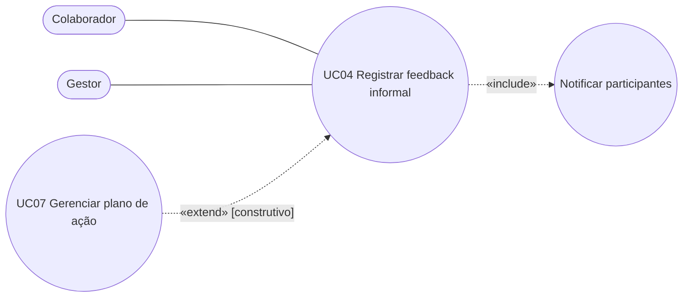

# Caso de uso UC04: Registrar feedback informal

Sistema web de feedback e desenvolvimento de competências.

Versão 0.1, 17/11/2026. Responsável: Gabriel Mendes (P4). Os IDs seguem a [Lista Geral de Requisitos](requisitos.md).

> **Sobre o nome:** na divisão de tarefas este caso de uso se chama "Registrar feedback informal". Na lista geral ele é o **UC04 Dar feedback**. Para não criar um ID novo, usamos o **UC04**. O feedback informal é o feedback avulso, dado a qualquer momento (RF06), fora de uma rodada de avaliação.

## 1 Resumo

| Item | Descrição |
|---|---|
| ID | UC04 |
| Nome | Registrar feedback informal (Dar feedback) |
| Objetivo | Registrar em uma única tela um feedback positivo ou construtivo baseado em um fato, para que ele não se perca e possa ser acompanhado. |
| Atores principais | Colaborador, Gestor (o Gestor herda os casos de uso do Colaborador) |
| Ator secundário | Receptor do feedback (recebe a notificação) |
| Requisitos | RF06, RF07, RF08, RF09, RF10; RN01, RN02, RN04; RNF04, RNF05 |
| Relacionamentos | `<<include>>` Notificar participantes; `<<extend>>` UC07 Gerenciar plano de ação [construtivo] |
| Dores resolvidas | D01, D03 e D04 do [BPMN do processo atual](bpmn-processo-avaliacao.md) |
| Prioridade | Alta (é o centro do sistema: "dar um feedback cabe em uma tela só") |



## 2 Condições

**Pré-condições**

1. O ator está autenticado no sistema (UC01).
2. O receptor está cadastrado e ativo (UC02).

**Gatilho:** o ator presencia um comportamento ou resultado de um colega e decide registrar um feedback.

**Pós-condições de sucesso**

1. O feedback fica registrado com emissor, receptor, tipo, fato, texto, competência (se houver) e data e hora do envio (RNF04).
2. O feedback não pode mais ser editado nem excluído; só recebe comentários (RF08, RN02).
3. O receptor é notificado na plataforma e vê o feedback em "Meu desenvolvimento" (RF09, RF20).
4. O feedback fica visível apenas para o receptor, o emissor, o gestor do receptor e o RH (RN04).

**Garantia mínima:** se o envio não for concluído, nenhum feedback é registrado.

## 3 Fluxo principal

1. O ator escolhe **"Dar feedback"** no menu.
2. O sistema exibe a tela única de feedback, com a data e o emissor já preenchidos (RF06).
3. O ator seleciona o **receptor**, buscando pelo nome entre os usuários ativos.
4. O ator escolhe o **tipo**: positivo ou construtivo.
5. O sistema mostra no campo de feedback a **dica do roteiro** do tipo escolhido (RF07):
   - positivo: o que a pessoa fez, o resultado e o impacto para o gestor, o time e a organização;
   - construtivo: um ponto positivo, o fato, o impacto e a pergunta "o que pode ser feito para não acontecer de novo?".
6. O ator descreve o **fato**: o que aconteceu e quando (RN01).
7. O ator escreve o **feedback**. Seguir a dica não é obrigatório.
8. Opcionalmente, o ator escolhe uma **competência**. A lista mostra as competências do cargo do receptor e as competências específicas dele (RF04, RF05).
9. O ator clica em **"Enviar"**.
10. O sistema valida os campos: receptor, tipo e fato preenchidos.
11. O sistema registra o feedback com emissor, data e hora (RNF04).
12. O sistema notifica o receptor na plataforma (`<<include>>` Notificar participantes, RF09).
13. O sistema confirma o envio e mostra o feedback na lista de feedbacks dados pelo ator. O caso de uso termina.

## 4 Fluxos alternativos

**A1 Feedback construtivo: criar plano de ação (RF10)**
No passo 13, se o tipo for construtivo, o sistema mostra também o botão **"Criar plano de ação"**, já ligado ao feedback.
1. O ator clica no botão.
2. O sistema inicia o **UC07 Gerenciar plano de ação**, com o feedback e o receptor já preenchidos (`<<extend>>`).

Se o ator não clicar, o caso de uso termina normalmente. *Interpretação a validar com o grupo:* como o RF12 diz que quem cria o plano é o gestor, o botão aparece apenas quando o emissor é o gestor do receptor.

**A2 Desistir antes de enviar**
Em qualquer passo antes do 9, o ator clica em "Cancelar".
1. Se algum campo foi preenchido, o sistema pede confirmação.
2. O ator confirma; o sistema descarta os dados e nada é registrado. O caso de uso termina.

**A3 Comentar um feedback já enviado (RF08)**
O emissor ou o receptor abre um feedback já enviado.
1. O ator escreve um comentário e clica em "Comentar".
2. O sistema registra o comentário com autor, data e hora (RNF04) e o mostra abaixo do feedback, para os dois.

## 5 Fluxos de exceção

**E1 Fato não preenchido (RN01)**
No passo 10, o fato está vazio. O sistema mostra a mensagem "Descreva o fato: o que aconteceu e quando.", mantém os outros dados e volta ao passo 6.

**E2 Tipo ou receptor não escolhido**
No passo 10, falta o tipo ou o receptor. O sistema indica o campo que falta e volta ao passo correspondente (3 ou 4).

**E3 Receptor desativado durante o preenchimento**
No passo 10, o receptor foi desativado depois de ter sido selecionado. O sistema informa que o usuário não está mais ativo e volta ao passo 3, mantendo o texto digitado.

**E4 Tentativa de editar ou excluir (RF08, RN02)**
O sistema não oferece as opções de editar nem de excluir um feedback enviado. Correções e complementos são feitos por comentário (A3).

## 6 Regras e requisitos aplicados

| ID | Como se aplica neste caso de uso |
|---|---|
| RF06 | Tela única com receptor, tipo, fato (obrigatório), feedback e competência (opcional); data e emissor automáticos |
| RF07 | Dica do roteiro conforme o tipo, sem obrigatoriedade |
| RF08, RN02 | Sem edição nem exclusão depois do envio; comentários de emissor e receptor |
| RF09 | Notificação ao receptor e exibição no painel dele |
| RF10 | Botão "Criar plano de ação" no feedback construtivo |
| RN01 | Fato obrigatório; feedback sobre comportamento ou resultado, nunca sobre personalidade |
| RN04 | Visibilidade: receptor, emissor, gestor do receptor e RH |
| RNF04 | Registro de quem criou e quando (feedback e comentários) |
| RNF05 | Uma tela só, linguagem simples, em português do Brasil |

## 7 Rascunho da tela

Esboço em texto para orientar o protótipo no Figma (responsabilidade do Caique).

```text
┌────────────────────────────────────────────────────────────┐
│ Dar feedback                              17/11/2026 · Você│
├────────────────────────────────────────────────────────────┤
│ Para quem? *        [ Buscar colega pelo nome...        ▾ ]│
│ Tipo *              ( ) Positivo   ( ) Construtivo         │
│ Fato *              [ O que aconteceu e quando?           ]│
│                     [                                     ]│
│ Feedback            [ Dica: o que a pessoa fez, o         ]│
│                     [ resultado e o impacto...            ]│
│ Competência         [ (opcional)                        ▾ ]│
│                                                            │
│                               [ Cancelar ]  [ Enviar ]     │
└────────────────────────────────────────────────────────────┘
  Após enviar um construtivo:  ✓ Feedback enviado  [ Criar plano de ação ]
```
